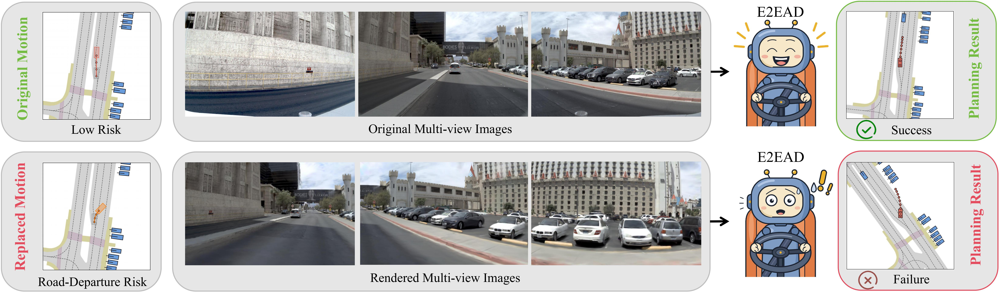
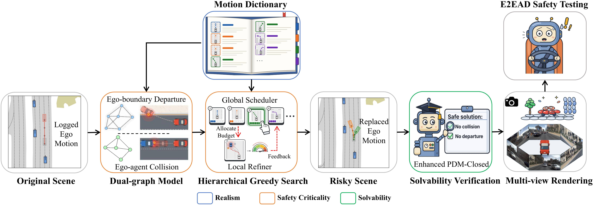
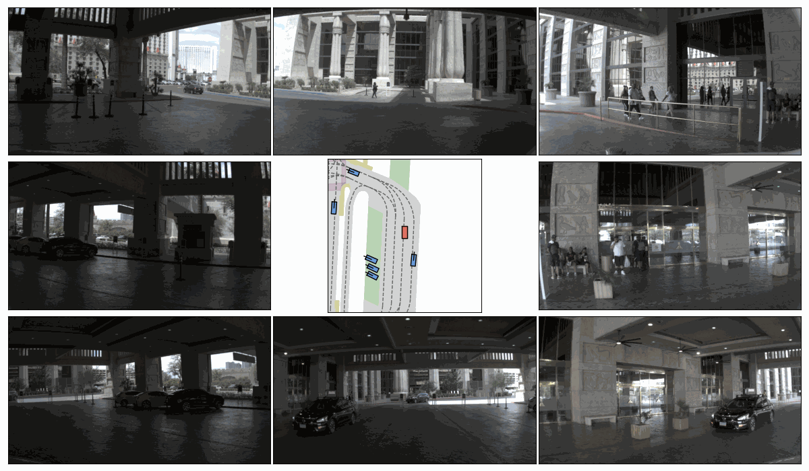
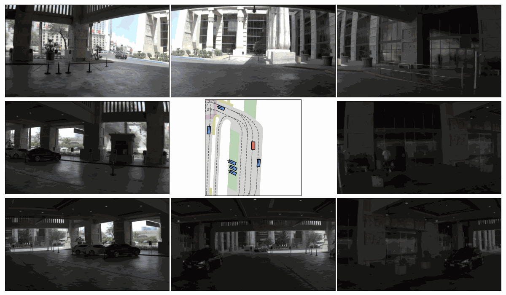
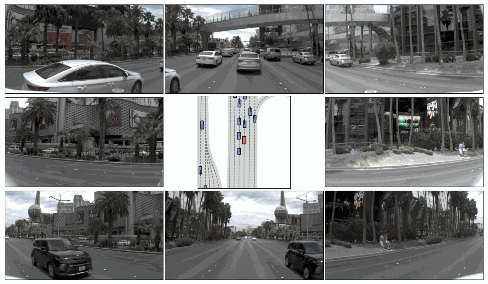
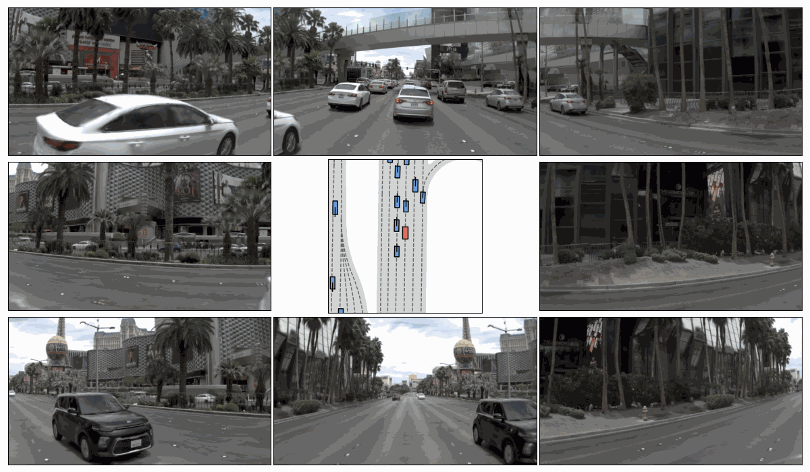
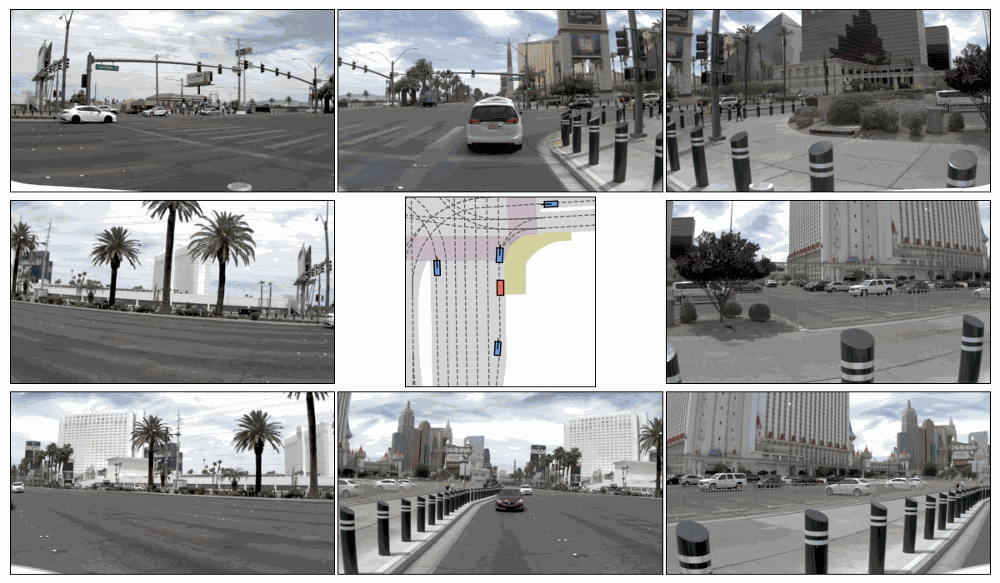
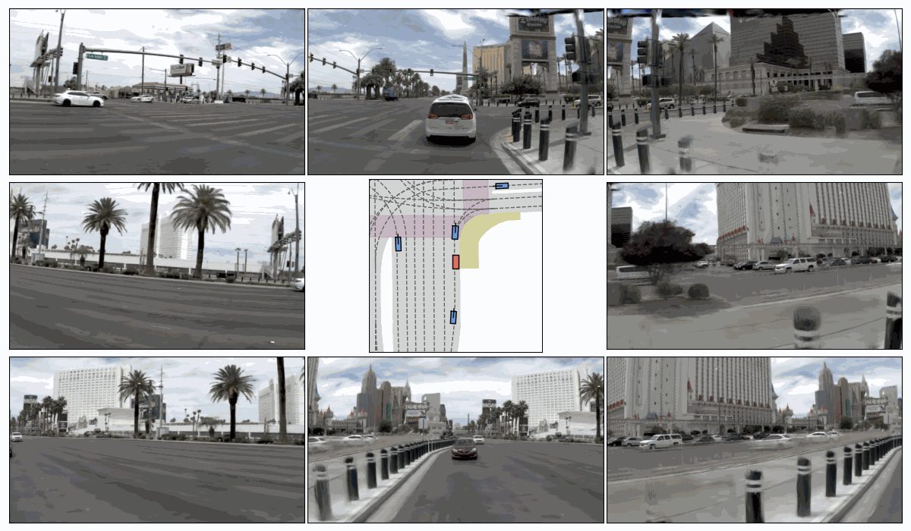

# TriSafe: Generating Realistic, Safety-Critical, and Solvable Test Cases for End-to-End Autonomous Driving via Ego-Motion Replacement

  

*While the E2EAD model successfully handles the naturalistic common scenario,
TriSafe generates the riskier counterfactual test case through ego-motion
replacement and photorealistic multi-view rendering, effectively uncovering
latent planning vulnerabilities in tested models.*

## Overview

  

Given an input scene, TriSafe explores candidate maneuvers from a motion
dictionary of recorded human ego trajectories. For each evaluated
candidate, an ego-centric dual-graph model encodes the resulting ego-agent and
ego-boundary relations and quantifies temporal changes in collision and
road-departure risks. These risk changes guide a hierarchical greedy search
under a limited evaluation budget, with a global scheduler allocating the
budget across maneuver modes and a local refiner seeking valid risk-escalating
candidates within the selected mode. Once the budget is exhausted, the best
valid candidate found in each mode is used to construct a separate risky scene.

The enhanced PDM-Closed expert then searches for a safe trajectory in each
scene, retaining only scenes for which such a trajectory is identified.
Finally, the retained scenes are rendered into photorealistic multi-view
images, yielding test cases for direct evaluation of E2EAD planners.

## Demo

Each row shows an original scene (left) and the corresponding scene
generated by TriSafe after ego-motion replacement (right).

<table>
  <tr>
    <th align="center">Original Scene</th>
    <th align="center">Ego-Motion Replaced Scene</th>
  </tr>
  <tr>
    <td></td>
    <td></td>
  </tr>
  <tr>
    <td></td>
    <td></td>
  </tr>
  <tr>
    <td></td>
    <td></td>
  </tr>
</table>

## Getting Started

| Step | Document | Content |
| --- | --- | --- |
| 1 | [Installation](docs/install.md) | Environment requirement|
| 2 | [Data Preparation](docs/data_prepare.md) | nuPlan and NAVSIM (test split) data|
| 3 | [Test Case Generation](docs/test_case_generation.md) | Motion dictionary, hierarchical greedy search, risky scene construction, solvability verification, multi-view rendering|
| 4 | [Model Testing](docs/model_testing.md) | Evaluation of E2EAD models |

Run every command from the repository root.

## Repository Layout

| Path | Content |
| --- | --- |
| `trajectory_candidate/` | Motion dictionary and its hierarchical structure |
| `Hierarchical Greedy Search/` | Hierarchical greedy search and dual-graph risk evaluation |
| `nuplan_scripts/` | Scene reconstruction pipeline, risky scene construction and rendering, solvability check|
| `scripts/` | Entry-point shell scripts for every step |
| `data/auto_reconstruction/` | Reconstruction configs and the config-to-token list|
| `mtgs/` | MTGS model |
| `navsim/` | NAVSIM with the synthetic-scene evaluator |
| `nuplan-devkit/` | nuPlan devkit |
| `thirdparty/` | KISS-ICP and UniDepth, used by the reconstruction pipeline |

## Acknowledgements

This repository is built upon the following open-source projects. We sincerely thank the authors for their great work:

- [MTGS](https://github.com/OpenDriveLab/MTGS/)
- [SimScale](https://github.com/OpenDriveLab/SimScale)
- [PDM-Closed](https://github.com/autonomousvision/tuplan_garage)
- [NAVSIM](https://github.com/autonomousvision/navsim)

## License

This repository is released under the Apache-2.0 license (see `LICENSE`).
Data derived from nuPlan and NAVSIM is subject to the nuPlan and NAVSIM dataset
licenses (CC BY-NC-SA 4.0).
